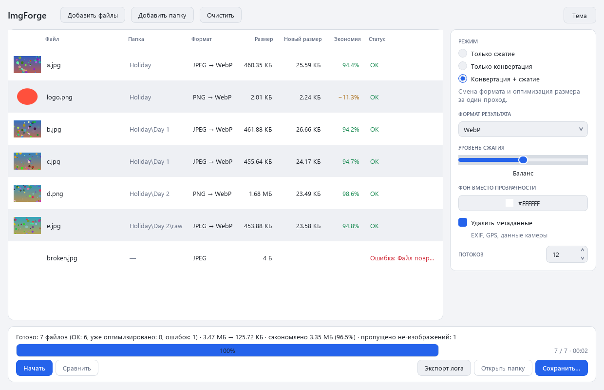

# ImgForge

A Windows desktop image converter and compressor (Russian UI) — drop photos or whole folders,
choose a mode, get smaller files in the format you want, with the folder structure preserved.


<!-- Replace docs/screenshot.png with a screenshot of the real window if you like. -->

## Features

- **Three modes** — *compress only* (keep the format, like tinypng.com), *convert only* (high quality,
  no extra compression), *convert + compress*.
- **Formats** — input: PNG, JPEG, WebP, AVIF, GIF, BMP, TIFF, HEIC/HEIF · output: PNG, JPEG, WebP, AVIF, GIF, BMP, TIFF.
- **Visually lossless compression** — PNG: libimagequant palette quantization + oxipng; JPEG: progressive,
  4:2:0, mozjpeg-optimised Huffman tables; WebP/AVIF: max-effort lossy encoders. A three-position slider
  (*max quality / balanced / smallest*).
- **Never bigger** — in compress mode (and whenever the format stays the same) a result that is not smaller
  than the original is replaced by an unchanged copy of the original and marked *Уже оптимизировано*.
- **Correct conversion** — transparency flattened on a chosen colour for JPEG/BMP, animated GIF/WebP/AVIF/APNG keep
  all frames and timings (first frame + a warning when the target cannot animate), EXIF orientation applied,
  ICC profiles preserved or converted to sRGB, CMYK / 16-bit / palette / grayscale handled.
- **Files and folders** — drag & drop or buttons, any nesting depth, non-images silently skipped (counted),
  thumbnails loaded lazily in a virtualized table.
- **Safe output** — everything is processed in a temporary folder, originals are never touched. *Сохранить…*
  opens the Windows folder picker and recreates the input structure; name clashes ask *Overwrite / Rename (`_1`) / Skip*.
- **No limits** — no pixel limit (decompression-bomb check disabled), a pool of worker processes
  (default: CPU cores), UI never blocks, progress / elapsed / ETA, safe *Cancel*.
- **Before / after** — double-click a processed row: draggable split, wheel zoom, pan, 100% pixel view.
- **Metadata removal** (default on), results table, summary, *Export log*, light/dark/system theme,
  remembered settings, keyboard shortcuts: `Ctrl+O`, `Ctrl+Shift+O`, `Ctrl+Enter`, `Ctrl+S`, `Delete`.

## Run from source

Requires Windows and Python 3.11+.

```powershell
python -m venv .venv
.\.venv\Scripts\activate
pip install -r requirements-dev.txt
python -m imgforge
```

## Run the tests

```powershell
python -m pytest
```

The suite covers every input → output format pair, transparency flattening, animation, EXIF orientation,
metadata/ICC handling, nested-folder mirroring and conflict resolution, the "result larger than original"
fallback, corrupted files, the process-pool batch runner and a headless GUI smoke test (offscreen Qt).

## Build the single .exe

```powershell
pip install -r requirements-dev.txt
pyinstaller build.spec --noconfirm
```

The portable `dist\ImgForge.exe` (~60 MB, no installation, all codecs bundled) is created. To verify a build
without opening a window:

```powershell
.\dist\ImgForge.exe --selftest result.txt   # writes "SELFTEST PASSED" to result.txt
```

## Project layout

```
imgforge/
  core/        Qt-free processing core (also imported by the worker processes)
    formats.py     format registry and capabilities, Pillow plugin setup
    options.py     Mode, QualityLevel, ProcessingOptions
    models.py      SourceItem, FileResult, Status, summarize()
    converter.py   decode, orientation, colour management, flattening, animation, encoders
    compressor.py  quality profiles, libimagequant / oxipng / mozjpeg primitives
    scanner.py     recursive scan, de-duplication, skipped-file count
    pipeline.py    process_file() and BatchRunner (process pool, cancel, crash recovery)
    saver.py       structure-mirroring save with Overwrite / Rename / Skip
    preview.py     thumbnails and display images
    report.py      text log
  gui/         PySide6 interface
    main_window.py, compare_view.py, workers.py (QThreads), settings.py (QSettings)
    widgets/       drop zone, queue model, thumbnails, settings panel, conflict dialog
    themes/        colour tokens, style sheet, theme manager
  main.py      entry point (also --selftest)
tests/         pytest suite
assets/        application icon (scripts/make_icon.py regenerates it)
build.spec     PyInstaller spec
```

## Behaviour notes

- **HEIC/HEIF in compress-only mode** cannot be written back, so the result is a JPEG (with a note in the table).
- **Metadata removal vs. "keep the original"** — if the original would be kept but it carries EXIF/GPS/XMP and
  metadata removal is on, JPEG/PNG are re-optimised *losslessly* with the metadata stripped; other formats are
  re-encoded instead, so private data never survives by accident.
- **Cancel** stops submitting new files; files already in progress finish and their results stay available for saving.
- **AVIF speed** is chosen by image size (speed 2 up to 4 MP, 4 up to 16 MP, 5 above): speeds 0–1 are slower and
  not smaller than 2 with libaom.
- **TIFF** keeps ICC profile and DPI; EXIF is not written to TIFF. 16-bit grayscale is reduced to 8-bit.
- Settings are stored in the registry under `HKCU\Software\ImgForge\ImgForge`.
